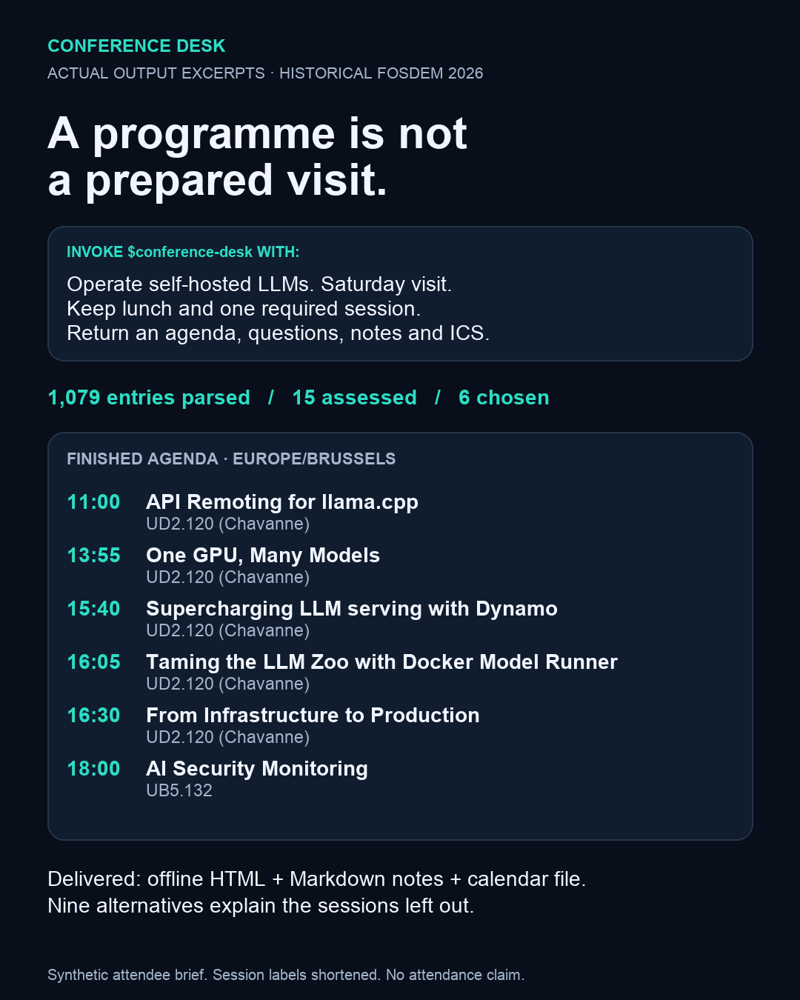
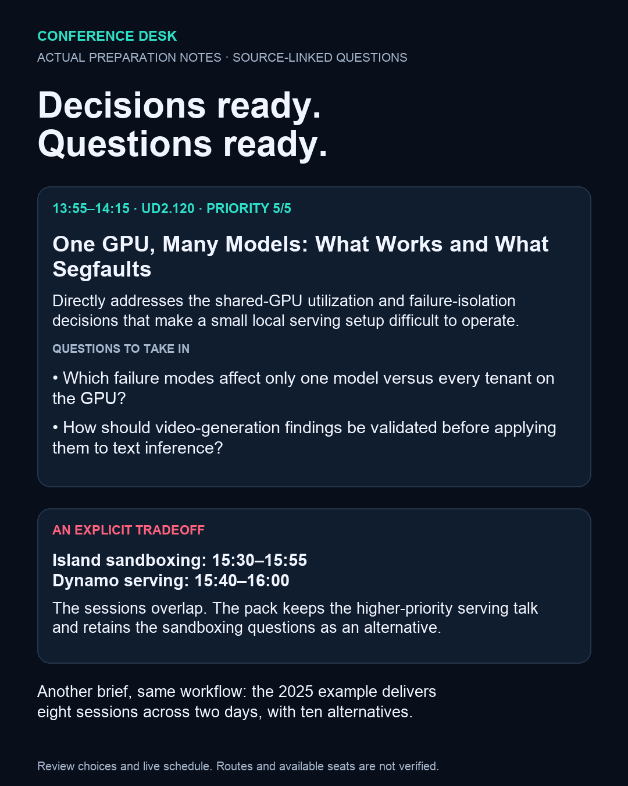

# Conference Desk

A conference programme is only the start of preparing for a visit. You still need to read abstracts, decide what helps your goal, resolve overlaps, leave time to move and eat, prepare questions, and copy the result into something you can carry.

Conference Desk gives that job to an agent. Supply the official programme, a short attendee brief and an output directory. The agent reads the relevant programme, makes and explains the choices, prepares session questions and notes, and leaves a checked **offline HTML pack, Markdown notes and an importable ICS calendar**.



## Try it

Requires Python 3.11+ and an existing agent session with filesystem/shell access. New programmes also require access to their public schedule. No third-party Python packages or new API key are needed by the tool. If Python lacks a configured CA bundle on macOS, the downloader uses an installed `curl` with certificate verification enabled. Your normal agent host/account still applies.

```sh
git clone https://github.com/GN25/Conference-Desk.git
cd Conference-Desk
```

The quickest path needs no installation. Open an agent in this directory and ask:

> Read conference-desk/SKILL.md and prepare a pack from https://archive.fosdem.org/2026/schedule/xml for a platform engineer operating self-hosted LLMs. Use the attendee preferences in examples/fosdem-2026/brief.json. Save the finished result in runs/my-visit. This is a historical programme replay.

The same input pattern works for the next supported conference: its XML URL, your goal, dates/hours, breaks and any required sessions. You do not need to score talks or write the decisions JSON yourself. The agent does that work.

To install the same complete folder as a reusable skill, choose one host:

```sh
# Codex
mkdir -p ~/.agents/skills
cp -R conference-desk ~/.agents/skills/conference-desk
# Claude Code
mkdir -p ~/.claude/skills
cp -R conference-desk ~/.claude/skills/conference-desk
```

Do not overwrite an existing installation without reviewing it. Invoke `$conference-desk` in Codex or `/conference-desk` in Claude Code, followed by the programme and attendee brief. Both use the shared workflow and Python helpers in that folder. Installation locations and format were checked against [OpenAI's skill documentation](https://learn.chatgpt.com/docs/build-skills) and [Claude Code's documentation](https://code.claude.com/docs/en/skills). A separate Claude session was not launched or tested.

## Completed examples

These use real **historical public programmes** and explicitly synthetic attendee briefs. They do not claim attendance. The current authoring session performed the programme assessment and produced the notes; these are not separate host benchmark trials.

| Example | Programme entries | Detailed candidate notes | Selected sessions | Explained alternatives |
| --- | ---: | ---: | ---: | ---: |
| [FOSDEM 2026: LLM operations](examples/fosdem-2026/pack/agenda.md) | 1,079 | 15 | 6 | 9 |
| [FOSDEM 2025: reliable analytics](examples/fosdem-2025/pack/agenda.md) | 1,105 | 18 | 8 | 10 |

Download or clone, then open `examples/fosdem-2026/pack/index.html` or `examples/fosdem-2025/pack/index.html` in a browser. The files work locally; no server or hosted account is required. Source links require internet. For localhost viewing, run `python3 -m http.server 8766 --bind 127.0.0.1` and visit the example path.

In the first example, the agent chose model artifact management, GPU sharing, serving and monitoring sessions, kept lunch, and preserved the required self-hosting session. The sandboxing talk overlaps the serving talk. A room-change allowance is also applied throughout the plan. The pack explains that tradeoff and provides its questions as an alternative.

In the second, dbt-score and PyArrow are required. The agent prepares a different two-day agenda without changing the workflow. The highly relevant Postgres analytics session conflicts with PyArrow; it remains an explained alternative instead of becoming a hidden double booking.

To replay deterministic output production from the already completed agent assessment:

```sh
python3 conference-desk/scripts/desk.py build \
  --catalog examples/fosdem-2026/catalog.json \
  --brief examples/fosdem-2026/brief.json \
  --decisions examples/fosdem-2026/decisions.json \
  --out runs/replay-2026
python3 conference-desk/scripts/desk.py verify --out runs/replay-2026
```

This replays **saved decisions**. A new attendee goal requires the agent to read and reassess the programme; the Python helper alone does not understand relevance or draft questions.

## What the agent takes over

| Manual work | Finished result |
| --- | --- |
| Browse a large programme and interpret relevant abstracts | Goal-specific relevance notes grounded in source excerpts |
| Resolve session overlaps, departure times and room changes | A feasible agenda with a session cap and explicit alternatives |
| Keep breaks and required sessions | Hard constraints, with an error if required sessions cannot all fit |
| Prepare each session | Specific questions, preparation prompts, source and material links |
| Copy times, rooms and titles | UTC ICS events, a reading page and editable Markdown notes |
| Recheck an updated programme | Added/removed/changed-ID report and reassessment against a fresh catalog |

Defaults are 15 minutes between different rooms, no extra allowance in the same room, at most six sessions/day and a relevance threshold of 3/5. They are editable preferences, not measured logistics. Scores are the agent's assessment for the stated goal. Planning maximizes their sum subject to the constraints; it does not optimize a scientifically validated utility function.

## Refreshing

Ask the agent to refresh the existing pack using the official URL. It fetches a new catalog, compares stable IDs and fields, revisits changed or newly relevant sessions, preserves still-correct notes, and builds a new folder. Source hashes prevent accidentally applying the previous assessment to a different snapshot.

A calendar file is a snapshot. It is not a subscription and does not remove previously imported cancelled sessions from your calendar. Review a refresh before importing again. No calendar-account write, registration or message is performed by default.

## Checks and limits

Run `python3 -m unittest discover -s tests -v`. The suite checks the two completed packs, scheduling against exhaustive small-case solutions, mandatory conflicts, stale assessments, source excerpts, UTC/DST instants, Unicode ICS folding, preserved output directories and tampered files. The skill manifest was also validated. HTML output was visually inspected in Chrome. Calendar-account imports and independent Claude execution were not tested.

The included adapter handles the Pentabarf/frab XML dialect demonstrated by FOSDEM. Other programmes may need normalization by the agent or another adapter. Rooms, session dates and offsets must be present. It does not guarantee seats, route accessibility, walking time, talk quality or the correctness of a speaker's claims. Review the subjective choices and official programme before attending. Importing the calendar remains optional user work. HTML scratchpad notes are not persistent; use the Markdown file for durable notes.

Programme licensing, provenance and existing tools are documented in [ATTRIBUTION.md](ATTRIBUTION.md). This project adds goal-based preparation around public schedules; it is not an official FOSDEM application. No adoption, productivity or time-saving measurements are claimed.


